# timr-tui

[](https://crates.io/crates/timr-tui) [](https://github.com/sectore/timr-tui/actions/workflows/ci.yml) [](./LICENSE) [](https://ratatui.rs/)

TUI to organize your time: Pomodoro, Tabata, Countdown, Timer, Event.

- `[1] countdown` Use it for your workout, yoga/breathing sessions, meditation, handstand or whatever.
- `[2] timer` Check the time on anything you are doing.
- `[3] pomodoro` Organize your working time to be focused all the time by following the [Pomodoro Technique](https://en.wikipedia.org/wiki/Pomodoro_Technique). `Pomodoro` becomes [`Tabata`](https://en.wikipedia.org/wiki/High-intensity_interval_training#Tabata_regimen) by auto-detection.
- `[4] event` Count the time for any event in the future or past.

# Table of Contents

- [Preview](#preview)
- [CLI](#cli)
- [Notification](#notification)
- [Keybindings](#keybindings)
- [Installation](#installation)
- [Development](#development)
- [Misc](#misc)
- [Contributing](#contributing)
- [License](#license)

# Preview

_(theme depends on your terminal preferences)_

## Pomodoro

<a href="demo/pomodoro.gif">
  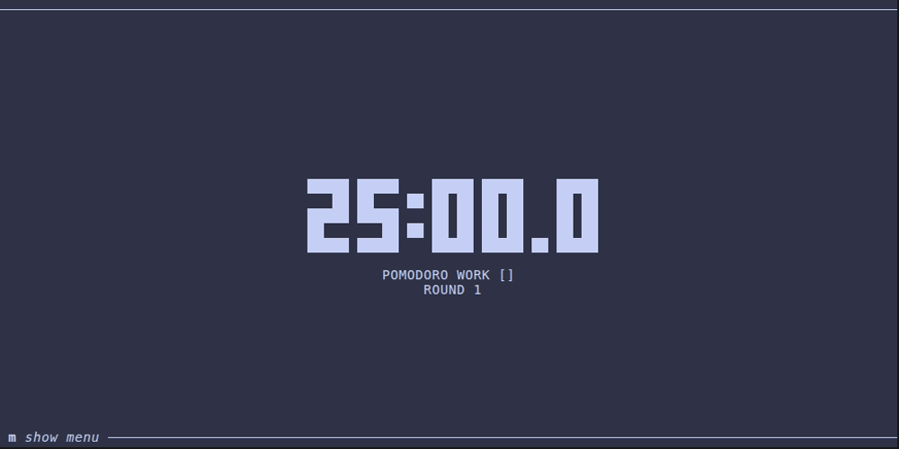
</a>

## [Tabata](https://en.wikipedia.org/wiki/High-intensity_interval_training#Tabata_regimen) (auto-detected)

<a href="demo/tabata.png">
  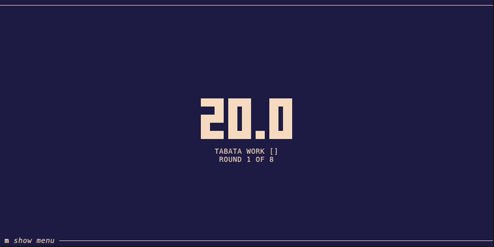
</a>

## Timer

<a href="demo/timer.gif">
  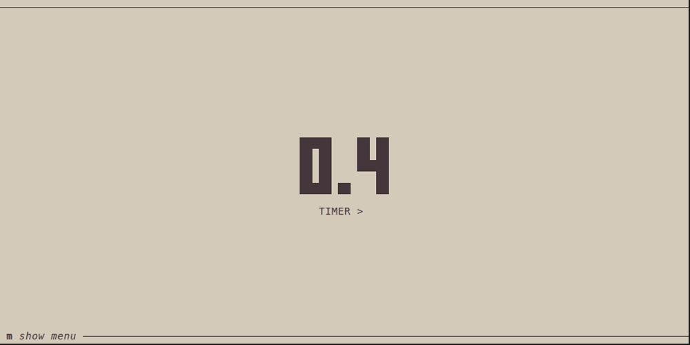
</a>

## Countdown (_incl. [Mission Elapsed Time](https://en.wikipedia.org/wiki/Mission_Elapsed_Time)_)

<a href="demo/countdown.gif">
  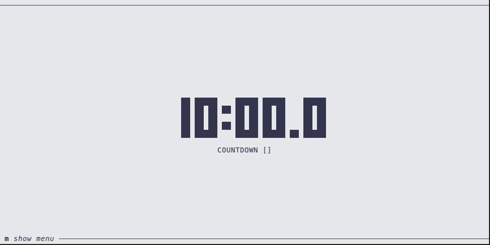
</a>

## Event (_past/future_)

<a href="demo/event.gif">
  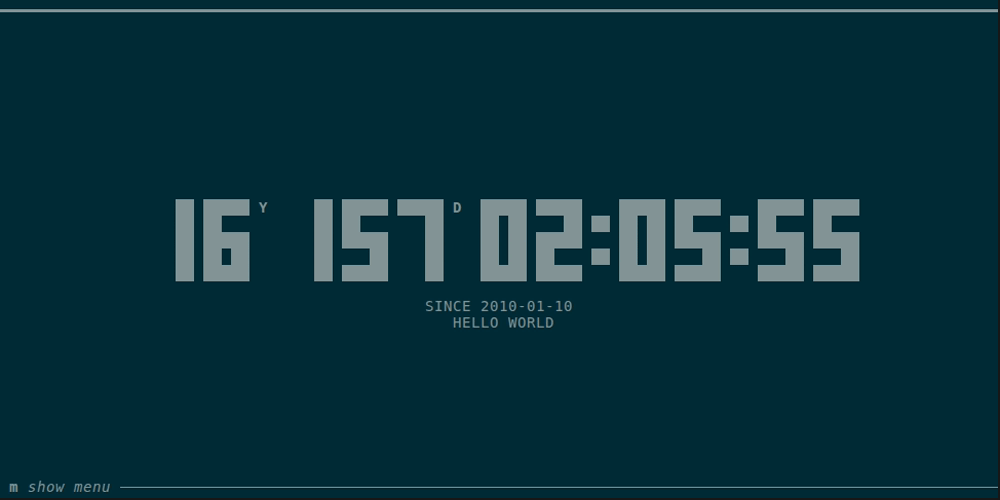
</a>

## Local time

<a href="demo/local-time.gif">
  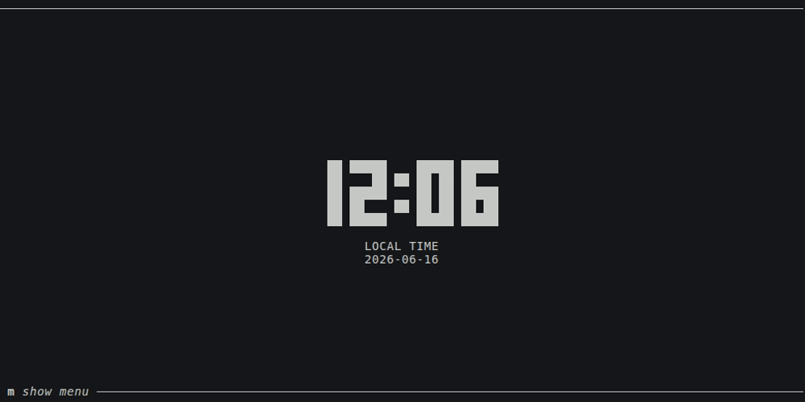
</a>

## Local time (_footer_)

<a href="demo/local-time-footer.gif">
  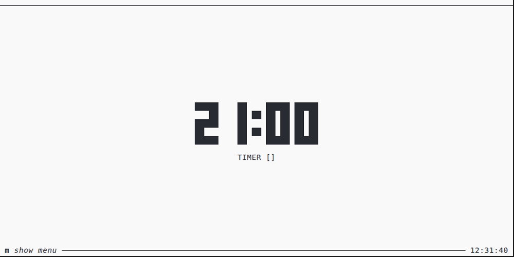
</a>

## Toggle deciseconds

<a href="demo/decis.gif">
  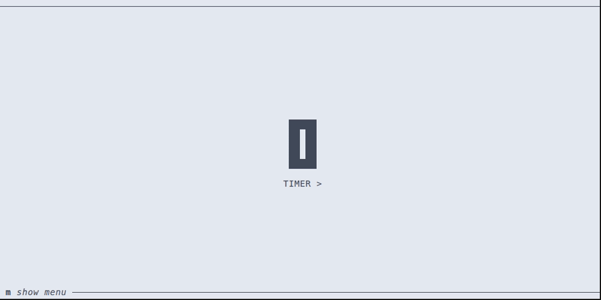
</a>

## Maximum (_`9999y`_ _`364d`_ _`23:59:59.9`_)

<a href="demo/timer-max.png">
  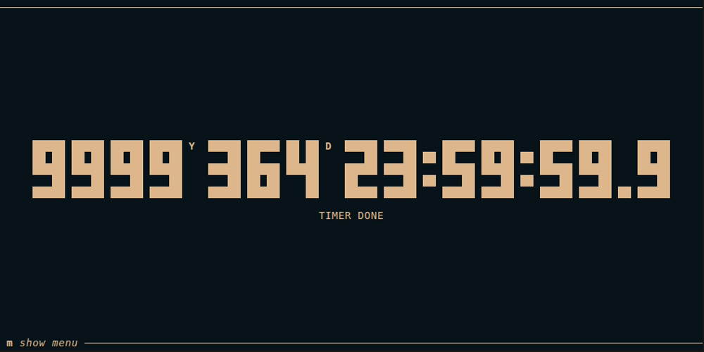
</a>

## Change style

<a href="demo/style.gif">
  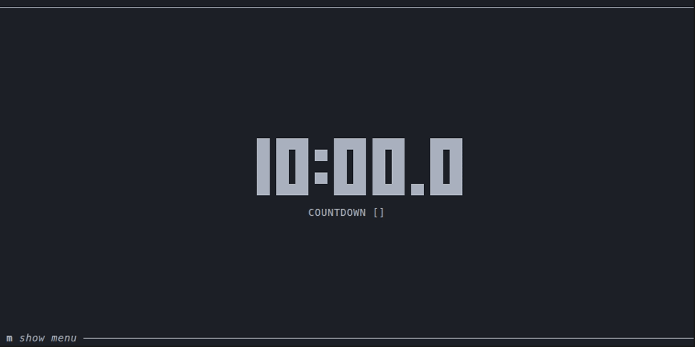
</a>

## Menu

<a href="demo/menu.gif">
  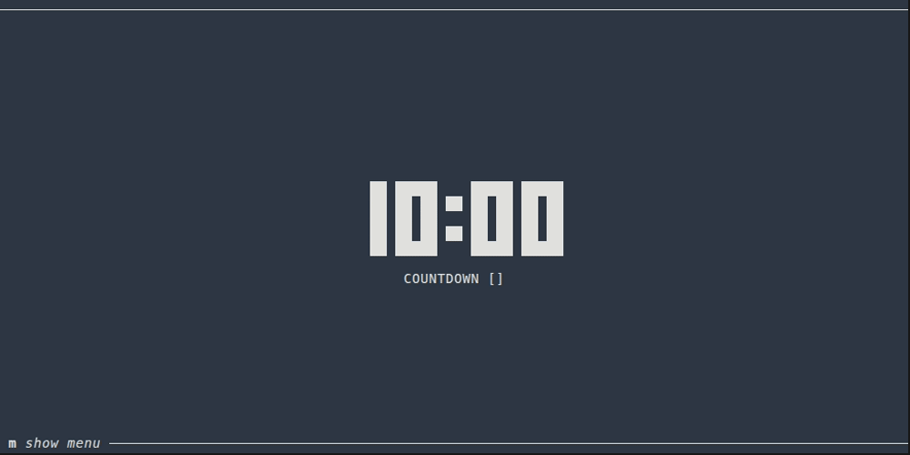
</a>

# CLI

```sh
timr-tui --help

Usage: timr-tui [OPTIONS]

Options:
  -c, --countdown <COUNTDOWN>        Countdown time to start from. Formats: 'Yy Dd hh:mm:ss', 'Dd hh:mm:ss', 'Yy mm:ss', 'Dd mm:ss', 'Yy ss', 'Dd ss', 'hh:mm:ss', 'mm:ss', 'ss'. Examples: '1y 5d 10:30:00', '2d 4:00', '1d 10', '5:03'.
  -w, --work <WORK>                  Work time to count down from. Formats: 'ss', 'mm:ss', 'hh:mm:ss'
  -p, --pause <PAUSE>                Pause duration. Single value (every round): '5:00'. Variable: 'regular,special[,every_n_rounds]' - special pause every N rounds, default every 4. Examples: '5:00,25:00' or '5:00,30:00,5'. Duration formats: 'ss', 'mm:ss', 'hh:mm:ss'.
      --max-rounds <MAX_ROUNDS>      Maximum number of pomodoro rounds. 0 = unlimited.
      --tabata                       Tabata regimen: work 20s, pause 10s, 8 rounds, auto-switch enabled.
      --auto-switch                  Enable auto-switch between `work` and `pause` screens.
  -e, --event <EVENT>                Event date time and title (optional). Format: 'YYYY-MM-DD HH:MM:SS' or 'time=YYYY-MM-DD HH:MM:SS[,title=...]'. Examples: '2025-10-10 14:30:00' or 'time=2025-10-10 14:30:00,title=My Event'.
  -d, --decis                        Show deciseconds.
  -m, --mode <MODE>                  Mode to start with. [possible values: countdown, timer, pomodoro, event, localtime]
  -s, --style <STYLE>                Style to display time with. [possible values: full, light, medium, dark, thick, cross, braille]
      --menu                         Open menu.
  -v, --vim <VIM>                    Enable/disable Vim motions. [possible values: on, off]
  -r, --reset                        Reset stored values to defaults.
  -n, --notification <NOTIFICATION>  Enable/disable desktop notifications. Experimental. [possible values: on, off]
      --blink <BLINK>                Enable/disable blink mode to animate a clock when it reaches its finished mode. [possible values: on, off]
      --sound [<SOUND>]              Sound notification: 'on', 'off' or path to a custom sound file (.mp3 or .wav).
      --log [<LOG>]                  Directory for log file. If not set, standard application log directory is used (check README for details).
  -h, --help                         Print help
  -V, --version                      Print version
```

`--sound` is not available in builds w/o sound (`timr-tui-nosound-*` [release binaries](#release-binaries) or built with `--no-default-features`).

# Notification

## Desktop

Toggle desktop notifications with `--notification on|off` or by pressing `d` (see [Keybindings](#keybindings)).

## Sound

A sound is played by default when a clock is done. Toggle it with `--sound on|off` or by pressing `s` (see [Keybindings](#keybindings)). `--sound` without a value equals `--sound on`.

A custom sound (`--sound <path>`) is used for the current session only. Every start without a path plays the default sound. To use a custom sound permanently, add an alias to your shell config, e.g. `alias timr='timr-tui --sound {path-to}/my-sound.mp3'`.

# Keybindings

Note: To enable Vim motions key binding, run with `--vim=on` once. It will be stored as part of settings, so only running once is needed. To disable, run `--vim=off`.

## Menu

| Key          | Description |
| ------------ | ----------- |
| <kbd>m</kbd> | Toggle menu |

## Screens

| Key          | Description                     |
| ------------ | ------------------------------- |
| <kbd>1</kbd> | Pomodoro                        |
| <kbd>2</kbd> | Countdown                       |
| <kbd>3</kbd> | Timer                           |
| <kbd>4</kbd> | Event                           |
| <kbd>0</kbd> | Local Time                      |
| <kbd>→</kbd> | next screen                     |
| <kbd>←</kbd> | previous screen                 |
| <kbd>l</kbd> | next screen _(Vim motions)_     |
| <kbd>h</kbd> | previous screen _(Vim motions)_ |

## Controls

| Key              | Description                 |
| ---------------- | --------------------------- |
| <kbd>space</kbd> | start/stop                  |
| <kbd>r</kbd>     | reset                       |
| <kbd>e</kbd>     | enter edit mode             |
| <kbd>d</kbd>     | toggle desktop notification |
| <kbd>s</kbd>     | toggle sound                |
| <kbd>q</kbd>     | quit                        |

**In `edit` mode only:**

| Key                          | Description                         |
| ---------------------------- | ----------------------------------- |
| <kbd>s</kbd>                 | save changes                        |
| <kbd>esc</kbd>               | skip changes                        |
| <kbd>←</kbd> or <kbd>→</kbd> | change selection                    |
| <kbd>h</kbd> or <kbd>l</kbd> | change selection _(Vim motions)_    |
| <kbd>↑</kbd>                 | edit to go up                       |
| <kbd>k</kbd>                 | edit to go up _(Vim motions)_       |
| <kbd>ctrl+↑</kbd>            | edit to go up 10x                   |
| <kbd>ctrl+k</kbd>            | edit to go up 10x _(Vim motions)_   |
| <kbd>↓</kbd>                 | edit to go down                     |
| <kbd>j</kbd>                 | edit to go down _(Vim motions)_     |
| <kbd>ctrl+↓</kbd>            | edit to go down 10x                 |
| <kbd>ctrl+j</kbd>            | edit to go down 10x _(Vim motions)_ |

**In `Event` `edit` mode only:**

| Key              | Description  |
| ---------------- | ------------ |
| <kbd>enter</kbd> | save changes |
| <kbd>esc</kbd>   | skip changes |
| <kbd>tab</kbd>   | switch input |

**In `Pomodoro` screen only:**

| Key                                    | Description                         |
| -------------------------------------- | ----------------------------------- |
| <kbd>ctrl+←</kbd> or <kbd>ctrl+→</kbd> | switch work/pause                   |
| <kbd>ctrl+h</kbd> or <kbd>ctrl+l</kbd> | switch work/pause _(Vim motions)_   |
| <kbd>a</kbd>                           | toggle auto switch work/pause       |
| <kbd>↑</kbd>                           | next round                          |
| <kbd>k</kbd>                           | next round _(Vim motions)_          |
| <kbd>↓</kbd>                           | previous round                      |
| <kbd>j</kbd>                           | previous round _(Vim motions)_      |
| <kbd>ctrl+↑</kbd>                      | increase max rounds                 |
| <kbd>ctrl+k</kbd>                      | increase max rounds _(Vim motions)_ |
| <kbd>ctrl+↓</kbd>                      | decrease max rounds                 |
| <kbd>ctrl+j</kbd>                      | decrease max rounds _(Vim motions)_ |
| <kbd>ctrl+r</kbd>                      | reset rounds                        |
| <kbd>ctrl+s</kbd>                      | save initial value                  |

**In `Countdown` screen only:**

| Key               | Description        |
| ----------------- | ------------------ |
| <kbd>ctrl+e</kbd> | edit by local time |
| <kbd>ctrl+s</kbd> | save initial value |
| <kbd>:</kbd>      | toggle finish time |

## Appearance

| Key          | Description        |
| ------------ | ------------------ |
| <kbd>,</kbd> | toggle styles      |
| <kbd>.</kbd> | toggle deciseconds |
| <kbd>:</kbd> | toggle local time  |

# Installation

## Cargo

On Linux, building w/ sound (default) requires the ALSA headers and `pkg-config`:

| Distro          | Packages                               |
| --------------- | -------------------------------------- |
| Debian / Ubuntu | `libasound2-dev`, `pkg-config`         |
| Fedora          | `alsa-lib-devel`, `pkgconf-pkg-config` |
| Arch            | `alsa-lib`, `pkgconf`                  |
| openSUSE        | `alsa-devel`, `pkg-config`             |
| Others          | ALSA headers + `pkg-config`            |

To build w/o sound, add `--no-default-features` to the commands below.

### From [crates.io](https://crates.io/crates/timr-tui)

```sh
cargo install timr-tui
```

### From GitHub repository

```sh
cargo install --git https://github.com/sectore/timr-tui
```

## Arch Linux

Install [from the AUR](https://aur.archlinux.org/packages/timr/):

```sh
paru -S timr
```

## Nix

_Note:_ Currently `timr-tui` is [available on the `unstable` channel](https://search.nixos.org/packages?channel=unstable&query=timr-tui) only.

### Command line

```sh
# default (w/o sound)
nix-env -iA nixpkgs.timr-tui
# or w/ sound enabled
nix-env -iA nixpkgs.timr-tui --arg timr-tui '(timr-tui.override { enableSound = true; })'
```

### Configuration

```nix
# default (w/o sound)
environment.systemPackages = with pkgs; [
  timr-tui
];
# or w/ sound enabled
environment.systemPackages = with pkgs; [
  (timr-tui.override { enableSound = true; })
];
```

### Home Manager

```nix
# default (w/o sound)
home.packages = with pkgs; [
  timr-tui
];
# or w/ sound enabled
home.packages = with pkgs; [
  (timr-tui.override { enableSound = true; })
];
```

Source at `nixpkgs`: <https://github.com/NixOS/nixpkgs/blob/nixos-unstable/pkgs/by-name/ti/timr-tui/package.nix>

## Release binaries

Pre-built artifacts are available to download from [latest GitHub release](https://github.com/sectore/timr-tui/releases).

| Platform                         | w/ sound                                  | w/o sound                                        |
| -------------------------------- | ----------------------------------------- | ------------------------------------------------ |
| Linux (x86_64)                   | `timr-tui-<version>-linux_x86_64.tar.gz`  | `timr-tui-nosound-<version>-linux_x86_64.tar.gz` |
| Windows (x86_64)                 | `timr-tui-<version>-windows_x86_64.zip`   | -                                                |
| macOS (Apple Silicon, macOS 14+) | `timr-tui-<version>-macos_aarch64.tar.gz` | -                                                |

Binaries w/ sound play a sound by default. To turn it off, use [`--sound off`](#cli) or press `s`.

Linux w/ sound requires glibc 2.28+ and `ALSA` to be installed. It's usually pre-installed on desktop systems. Without `ALSA` the binary doesn't start (`error while loading shared libraries: libasound.so.2`), so use `timr-tui-nosound-*` instead. It's statically linked and runs on any Linux (x86_64).

| Distro                     | Package                         |
| -------------------------- | ------------------------------- |
| Debian 12 / Ubuntu ≤ 23.10 | `libasound2`                    |
| Debian 13+ / Ubuntu 24.04+ | `libasound2t64`                 |
| Fedora                     | `alsa-lib`                      |
| Arch                       | `alsa-lib`                      |
| openSUSE                   | `libasound2`                    |
| Others                     | ALSA library (`libasound.so.2`) |

Windows / macOS: nothing to install.

# Development

## Requirements

### Nix users (recommend)

`cd` into root directory.

If you have [`direnv`](https://direnv.net) installed, run `direnv allow` once to install dependencies. In other case run `nix develop`.

### Non Nix users

- [`Rust`](https://www.rust-lang.org/learn/get-started)
- [`Clippy`](https://github.com/rust-lang/rust-clippy)
- [`rustfmt`](https://github.com/rust-lang/rustfmt)
- [`dprint`](https://dprint.dev)
- [`just`](https://just.systems)

### Commands

```sh
just

Available recipes:
    default                    # list commands

    [build]
    build                      # build app [alias: b]
    build-nosound              # build app without sound feature [alias: bn]

    [demo]
    demo-all                   # build all demos [alias: da]
    demo-blink                 # build demo: blink animation [alias: db]
    demo-countdown             # build demo: countdown [alias: dc]
    demo-countdown-finish      # build demo: countdown + finish time [alias: dcf]
    demo-countdown-max         # build demo: countdown-max [alias: dcmx]
    demo-countdown-met         # build demo: countdown + met [alias: dcm]
    demo-decis                 # build demo: deciseconds [alias: dd]
    demo-event                 # build demo: event [alias: de]
    demo-local-time            # build demo: local time [alias: dlt]
    demo-local-time-footer     # build demo: local time (footer) [alias: dltf]
    demo-menu                  # build demo: menu [alias: dm]
    demo-pomodoro              # build demo: pomodoro [alias: dp]
    demo-pomodoro-auto-special # build demo: pomodoro + auto-switch + special pause [alias: dpas]
    demo-rocket-countdown      # build demo: rocket countdown [alias: drc]
    demo-style                 # build demo: styles [alias: ds]
    demo-timer                 # build demo: timer [alias: dt]
    demo-timer-max             # build demo: timer-max [alias: dtm]

    [dev]
    run                        # run app [alias: r]
    run-args args              # run app with arguments. It expects arguments as a string (e.g. "-c 5:00"). [alias: ra]
    run-nosound args=""        # run app without sound feature. Optional arguments as string (e.g. "-c 5:00"). [alias: rn]

    [misc]
    format                     # format files [alias: f]
    lint                       # lint [alias: l]
    lint-nosound               # lint without sound feature [alias: ln]

    [test]
    test                       # run tests [alias: t]
    test-nosound               # run tests without sound feature [alias: tn]
```

### Build

- Linux

```sh
nix build
# or for bulding w/ statically linked binaries
nix build .#linuxStatic
```

- Windows (cross-compilation)

```sh
nix build .#windows
```

### Run tests

```sh
cargo test
```

# Misc

## Persistant app state

Stored on file system:

```sh
# Linux
~/.local/state/timr-tui/data/app.data
# macOS
/Users/{user}/Library/Application Support/timr-tui/data/app.data
# Windows
C:/Users/{user}/AppData/Local/timr-tui/data/app.data
```

## Logs

To get log output, start the app by passing `--log` to `timr-tui`. See [CLI](#cli) for details.

Logs will be stored in an `app.log` file at following locations:

```sh
# Linux
~/.local/state/timr-tui/logs/app.log
# macOS
/Users/{user}/Library/Application Support/timr-tui/logs/app.log
# `Windows`
C:/Users/{user}/AppData/Local/timr-tui/logs/app.log
```

Optional: You can use a custom directory by passing it via `--log` arg.

# Contributing

[CONTRIBUTING.md](./CONTRIBUTING.md)

# License

[MIT License](./LICENSE)

Default sound: [`confirmation-004`](https://www.soundcn.xyz/?category=Feedback&sound=confirmation-004) via [soundcn](https://github.com/kapishdima/soundcn), [CC0](https://creativecommons.org/publicdomain/zero/1.0/).
